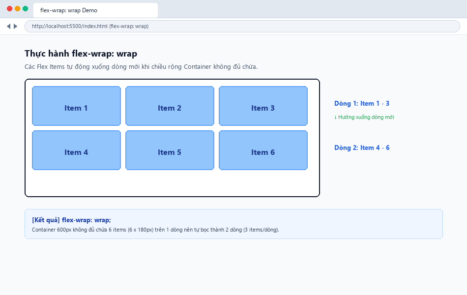
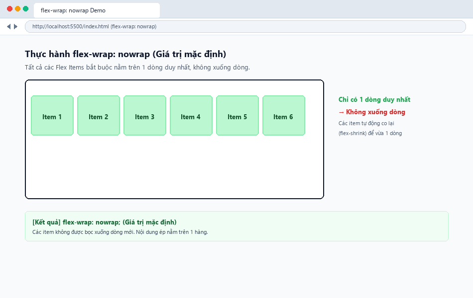
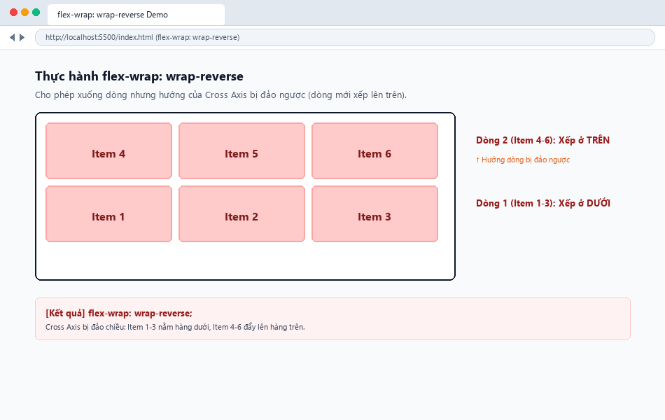
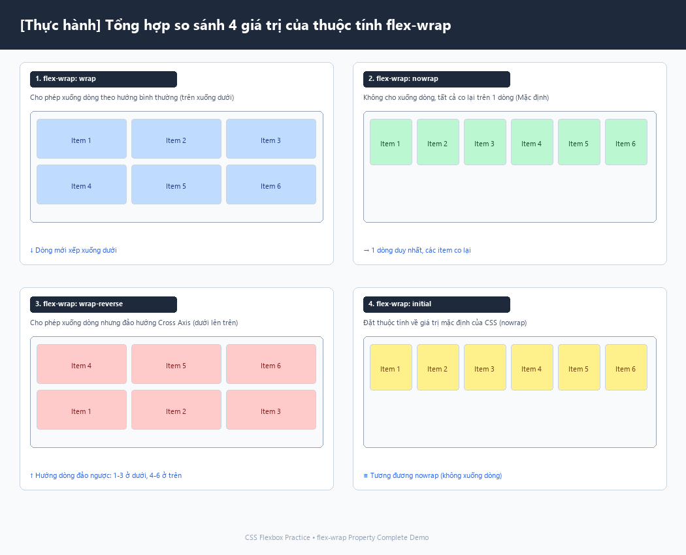

# [Thực hành] CSS | flex-wrap Property

Bài thực hành tìm hiểu và làm chủ thuộc tính `flex-wrap` trong **CSS Flexbox** nhằm kiểm soát cách các Flex Items xuống dòng khi không đủ không gian trong Flex Container.

---

## 📖 1. Khái niệm & Cú pháp

Thuộc tính `flex-wrap` xác định xem các phần tử con (**Flex Items**) có được phép bọc thành nhiều dòng hay bắt buộc phải nằm trên một dòng duy nhất khi vượt quá chiều rộng của phần tử cha (**Flex Container**).

### Cú pháp:
```css
flex-wrap: nowrap | wrap | wrap-reverse | initial;
```

---

## 🔍 2. Chi tiết các giá trị của `flex-wrap`

### 1. `wrap`
- **Công dụng:** Cho phép các Flex Items tự động xuống dòng khi chiều rộng không đủ.
- **Hướng dòng:** Tạo các dòng mới theo hướng thông thường của Cross Axis (từ trên xuống dưới trong bố cục hàng ngang `row`).
- **Thứ tự:** Dòng 1 chứa Item 1 &rarr; 3; Dòng 2 chứa Item 4 &rarr; 6.

### 2. `nowrap` *(Giá trị mặc định)*
- **Công dụng:** Bắt buộc tất cả Flex Items phải nằm trên 1 dòng duy nhất.
- **Hành vi:** Không cho phép xuống dòng. Các item sẽ tự động co nhỏ lại nếu `flex-shrink` cho phép, hoặc bị tràn ra ngoài viền Container nếu kích thước cố định.

### 3. `wrap-reverse`
- **Công dụng:** Cho phép các Flex Items xuống dòng, nhưng **đảo ngược hướng của Cross Axis**.
- **Hướng dòng:** Dòng mới được xếp ngược từ dưới lên trên.
- **Thứ tự:** Dòng 1 (Item 1 &rarr; 3) nằm ở **dưới cùng**, Dòng 2 (Item 4 &rarr; 6) nằm ở **phía trên**. Thứ tự bên trong từng dòng không thay đổi.

### 4. `initial`
- **Công dụng:** Đưa thuộc tính `flex-wrap` về giá trị mặc định ban đầu của CSS (tương đương với `nowrap`).

---

## 📊 3. Bảng tổng kết so sánh 4 giá trị

| Giá trị | Cho phép xuống dòng? | Hướng dòng (Cross Axis) | Đặc điểm chính |
| :--- | :---: | :---: | :--- |
| `wrap` | **Có** | Trên &rarr; Dưới | Phổ biến nhất cho bố cục Responsive, tự thích nghi khi thu nhỏ màn hình |
| `nowrap` | **Không** | Không áp dụng | Giá trị mặc định; các item co lại hoặc tràn viền container |
| `wrap-reverse` | **Có** | Dưới &rarr; Trên | Đảo ngược trục phụ; hàng đầu tiên nằm dưới, hàng tiếp theo xếp lên trên |
| `initial` | **Không** | Không áp dụng | Đưa về giá trị mặc định của CSS (tương đương `nowrap`) |

---

## 📸 4. Ảnh chụp kết quả trên trình duyệt

### Kết quả `flex-wrap: wrap;`:


### Kết quả `flex-wrap: nowrap;`:


### Kết quả `flex-wrap: wrap-reverse;`:


### Tổng hợp so sánh cả 4 giá trị:


---

## 📁 5. Cấu trúc thư mục dự án

```text
css-flex-wrap/
├── index.html                  # Giao diện tổng hợp + Interactive Playground thử nghiệm trực tiếp
├── style.css                   # Định kiểu CSS Flexbox và các container minh họa
├── screenshot_wrap.png         # Ảnh chụp kết quả flex-wrap: wrap
├── screenshot_nowrap.png       # Ảnh chụp kết quả flex-wrap: nowrap
├── screenshot_wrap_reverse.png # Ảnh chụp kết quả flex-wrap: wrap-reverse
├── tat_ca_gia_tri.png          # Ảnh tổng hợp so sánh cả 4 giá trị
└── README.md                   # Tài liệu thuyết minh chi tiết
```

---

## 🚀 6. Hướng dẫn chạy thử và kiểm tra
1. Mở file `index.html` bằng trình duyệt web bất kỳ (Chrome, Edge, Firefox).
2. Tại mục **Interactive Playground**, bấm lần lượt vào các nút:
   - `flex-wrap: wrap`
   - `flex-wrap: nowrap`
   - `flex-wrap: wrap-reverse`
   - `flex-wrap: initial`
3. Quan sát vị trí và thứ tự của các khối `Item 1` &rarr; `Item 6` biến đổi trực tiếp trên màn hình.
